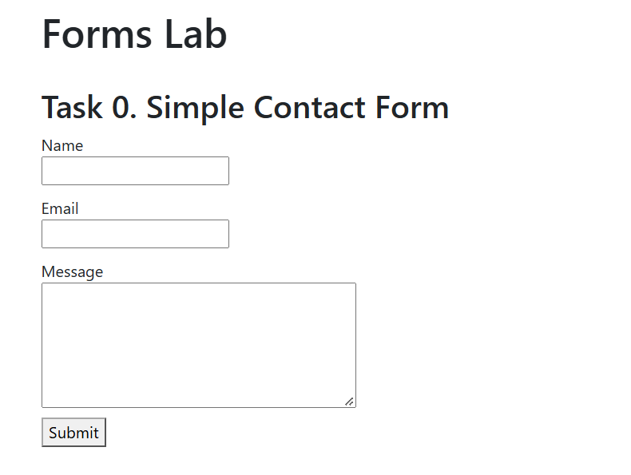
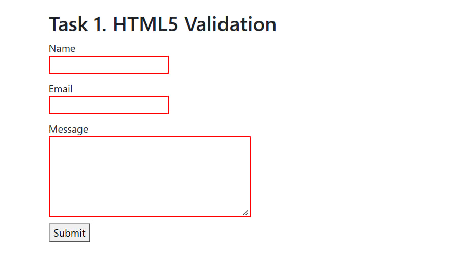
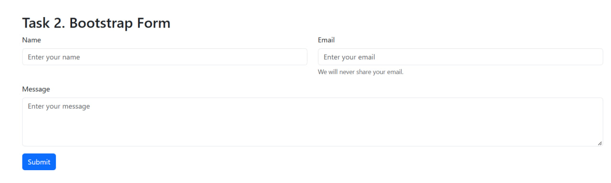
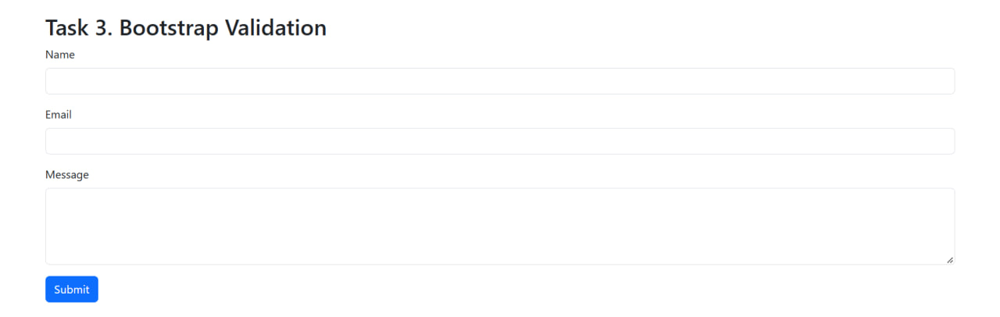
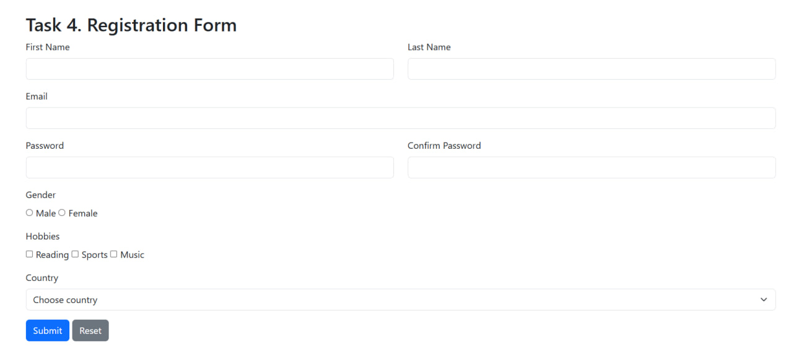

# Forms Lab

- **Student:** Tleubay Abilmansur
- **Group:** SE2540
- Link: https://pparalich.github.io/web_assignment4/
- Lab work on HTML forms, HTML5 validation and Bootstrap 5.3.

## Tasks

- **Task 0:** simple contact form (Name, Email, Message)
- **Task 1:** HTML5 validation (`required`, `minlength`, `maxlength`, `type="email"`)
- **Task 2:** contact form with Bootstrap grid, placeholders and helper text
- **Task 3:** Bootstrap validation (`is-valid` / `is-invalid`) with feedback messages
- **Task 4:** responsive registration form with validation

## Screenshots

### Task 0

### Task 1

### Task 2

### Task 3

### Task 4

## Files

- `index.html`: all tasks on one page
- `style.css`: custom styles
- `script.js`: validation logic for Task 3 and Task 4

## Run

Open `index.html` in a browser. Internet connection is needed for Bootstrap CDN.

## Technologies

HTML5, CSS3, Bootstrap 5.3, JavaScript